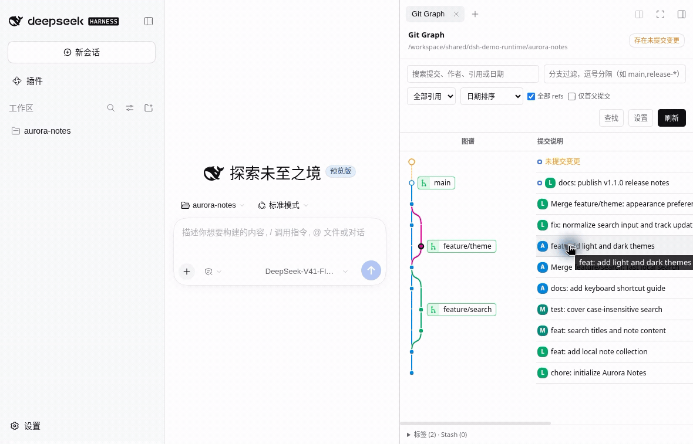
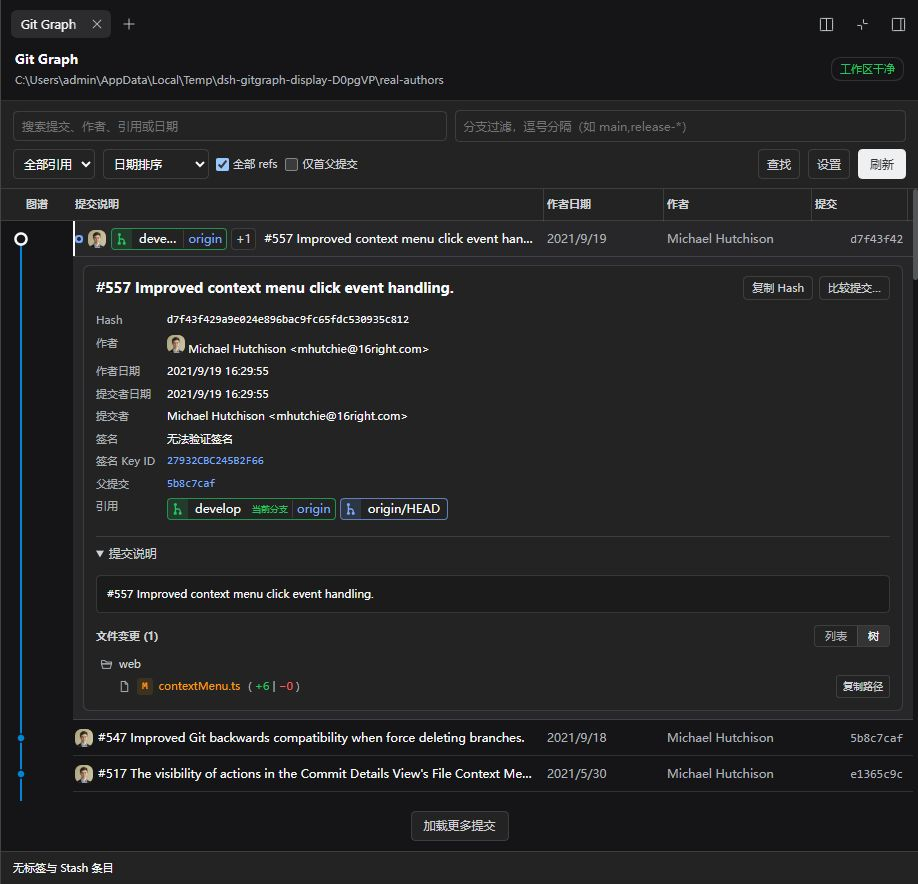
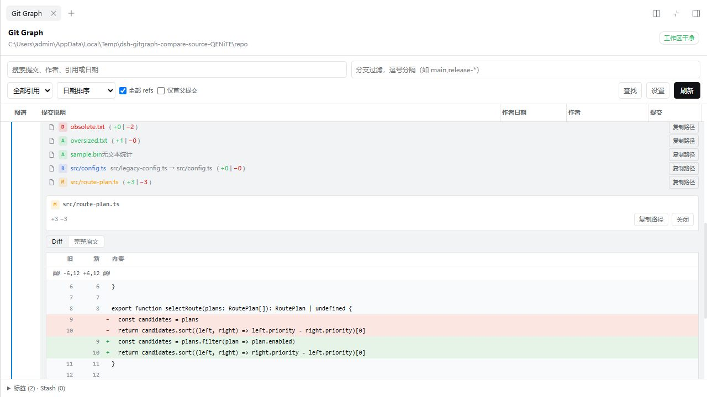
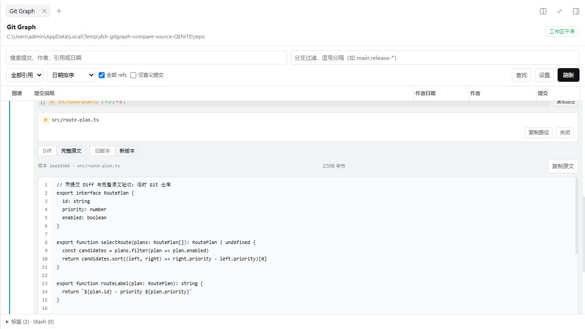
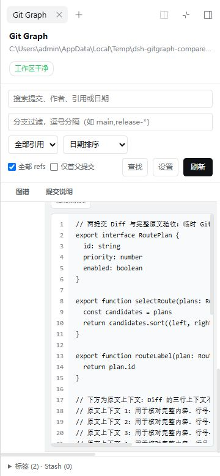
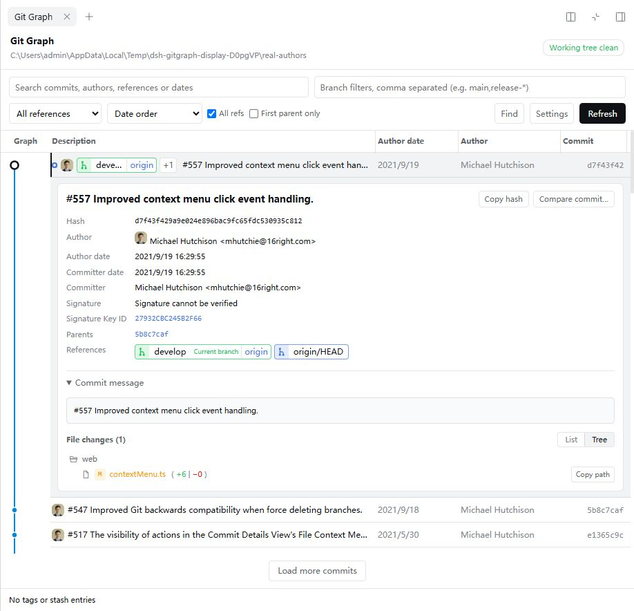
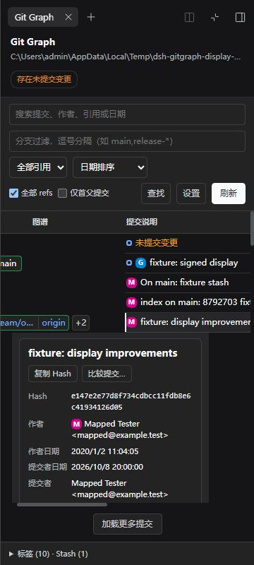
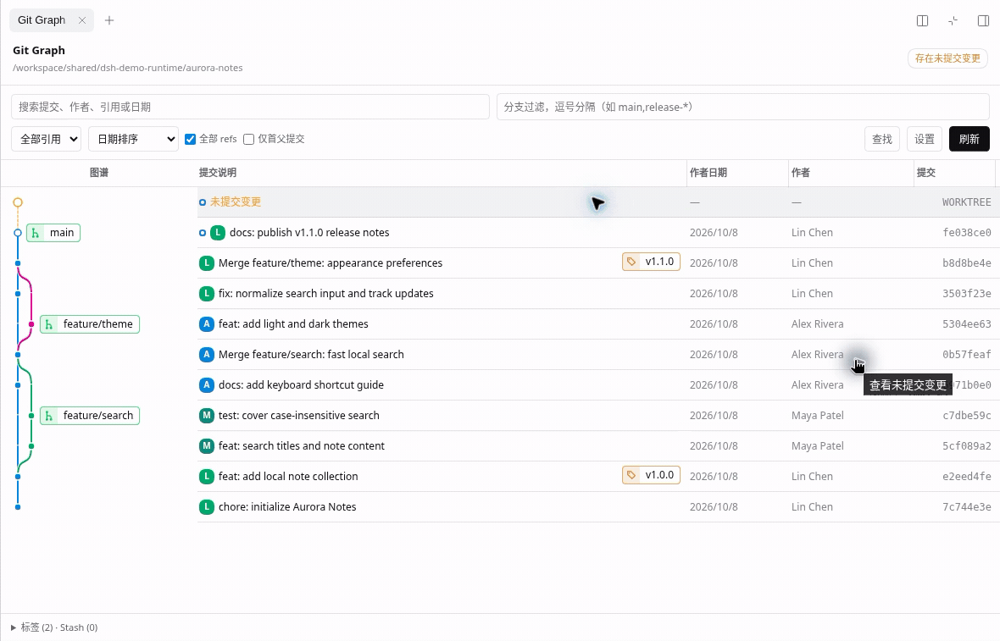
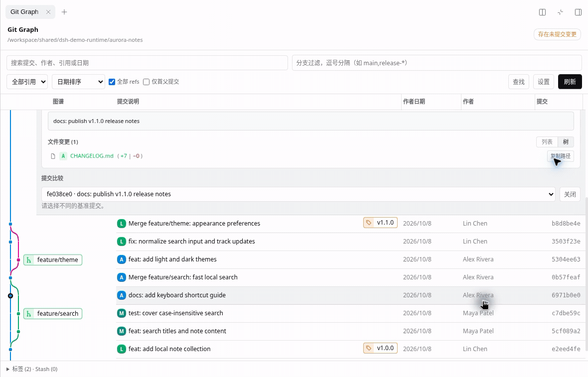

<p align="center">
  
</p>

<p align="center">
  <strong>Version 0.5.3</strong> · DSH 0.2.0-rc.2 · <a href="LICENSE">MIT</a><br>
  <a href="README.zh.md">中文说明</a> · <a href="docs/screenshots/readme-header.svg">Static title</a>
</p>

# dsh-git-graph

[dsh-git-graph](https://github.com/WhitePlusMS/dsh-git-graph) by **WhitePlusMS** is a read-only Git visualization plugin for the native right sidebar of **DeepSeek Harness (DSH) Web**. Browse your workspace's commit history, branches, and file changes without an API key or conversation message.

<p align="center">
  <a href="#install-or-update">Install</a> · <a href="#usage">Usage</a> · <a href="#keyboard-controls">Keyboard controls</a> · <a href="#faq">FAQ</a> · <a href="#scope">Scope</a> · <a href="#uninstall">Uninstall</a> · <a href="#documentation">Documentation</a>
</p>



The GIFs were recorded with 0.4.0. Screenshots of the 0.5.0 comparison and full-source views are below; the 0.5.2 reference and avatar changes are covered by the [acceptance record](docs/REFS_AVATAR_TEST_REPORT.md). 0.5.3 only rearranges the settings panel, so it has no new real-DSH screenshot.

<details>
<summary>More screenshots: commit comparison, full source, English, and narrow screens</summary>













</details>

## Features

- **History** — Commit topology, branches, tags, HEAD, search, and history filters.
- **Commit details** — Inline details with author/committer dates, parents, references, signature status, and copying.
- **References** — Every reference on a commit is shown; matching local/remote labels combine, chips wrap onto another line, and the row height follows. Two alternative layouts remain.
- **File changes** — File tree/list views, per-file diffs, and uncommitted changes; select two commits and open each changed file's diff.
- **Historical source** — Read and copy the complete text of an old or new file version, with its path, commit hash, line numbers, and size.
- **Messages & authors** — Commit messages with links, bold, italic, and inline code; real author avatars from GitHub, Gravatar, and the repository's own Git service (Gitea/Gogs).
- **Display settings** — Resizable columns, date display options, compact rows, line styles, and colour presets, saved per repository.
- **Interface** — Chinese/English, light/dark themes, pane fullscreen, and narrow-screen support.

**Commit details and file diffs**



**Commit comparison and uncommitted changes**



## Install or update

Requires DSH **0.2.0-rc.2**, the `dsh` CLI, pnpm for plugin installation, and Git installed on the DSH Host.

Install the prebuilt `v0.5.3` Release package through either DSH's plugin page or the CLI. Both accept the same package source. See the official [plugin manager guide](https://github.com/deepseek-ai/deepseek-harness/blob/dsh-v0.2.0-rc.2/packages/client/ui-plugin-manager/README.md) and [packaging guide](https://github.com/deepseek-ai/deepseek-harness/blob/dsh-v0.2.0-rc.2/docs/user/develop/basic/publish.md).

In DSH, open **Plugins → Add plugin**, paste this URL, install it, and choose **Enable now**:

```text
https://github.com/WhitePlusMS/dsh-git-graph/releases/download/v0.5.3/dsh-git-graph-0.5.3.tgz
```

Or install from the terminal:

```powershell
dsh plugin --profile web add https://github.com/WhitePlusMS/dsh-git-graph/releases/download/v0.5.3/dsh-git-graph-0.5.3.tgz
```

The archive includes the built `lib/` entry points. You do not need to clone this repository, build it locally, or keep a development folder at a fixed path.

This `.tgz` is built with `pnpm pack` and uploaded as a GitHub Release asset; it is separate from GitHub's automatically generated source archives. DSH supports installing this package URL in both the UI and CLI. Publishing a release does not automatically list the plugin in a marketplace; installing by package name alone requires an npm publication.

Check that `dsh-git-graph` is installed at version `0.5.3`:

```powershell
dsh plugin --profile web list dsh-git-graph
```

Start DSH Web with `dsh web`, or restart your existing instance to load the plugin. For updates, run `add` with the desired release tag, then restart that instance. Use the same profile name for installation, startup, and removal.

For a custom profile, local `.tgz` installation, or source builds, see the [development guide](docs/DEVELOPMENT.md#本地安装与自定义-profile).

## Usage

1. Select a workspace in DSH Web and open the right sidebar.
2. Select **dsh-git-graph** from the sidebar's start page.
3. Select a commit for inline details, or a file for its diff. Select **Uncommitted Changes** to inspect working-tree changes.
4. Choose **Compare commit…** and a base commit, then select a changed file. In a historical file viewer, switch between **Diff** and **Full source**, and choose the old or new version.

Use **Settings** to adjust the display. Settings are saved separately for each repository.

Real avatars are enabled by default and access external avatar services: GitHub repositories search public commits by author email; other repositories ask their own Git service first (Gitea/Gogs `/avatar` endpoint) and then Gravatar; GitHub noreply addresses resolve directly. You can disable them in Settings; missing images or failed requests retain initials.

## Uninstall

```powershell
dsh plugin --profile web remove dsh-git-graph
```

Use the profile you installed into, and restart it after removal.

## Keyboard controls

| Control | Action |
| --- | --- |
| `Ctrl/Cmd+F` | Find within loaded results |
| `Ctrl/Cmd+Shift+F` | Toggle display settings |
| `↑` / `↓` | Select a commit when Find is closed and cleared |
| `H` | Locate HEAD, or show an out-of-range hint |
| `Enter` / `Space` on a row or node | Select that commit |
| Drag a column divider / `←` / `→` | Resize a column; arrow keys work when the divider is focused |
| Double-click a divider | Restore its default width |

Shortcuts apply while focus is inside Git Graph. Normal navigation keys do not intercept typing in inputs or scrolling in a file viewer.

## FAQ

**How do I view commits and file diffs in DeepSeek Harness Web?**

[Install the plugin](#install-or-update) for DSH 0.2.0-rc.2, then open **dsh-git-graph** from the native right sidebar. See [Usage](#usage) for two-commit comparisons and full historical source.

**Why does DSH report `cannot resolve profile bundle "dsh-git-graph"`?**

A previous local-directory installation may still link to a folder that was moved or deleted. Reinstall the Release package in the same profile; removing it first also lets DSH register the bundle again if the old installation was no longer enabled:

```powershell
dsh plugin --profile web remove dsh-git-graph
dsh plugin --profile web add https://github.com/WhitePlusMS/dsh-git-graph/releases/download/v0.5.3/dsh-git-graph-0.5.3.tgz
```

Restart that DSH Web instance afterward. Running `dsh plugin --profile web install` alone reuses the saved package source and cannot repair a link to a missing folder.

**Do I need an API key or a conversation message?**

No. Git Graph reads the current workspace's local Git data directly.

**Can Git Graph commit, merge, push, pull, or fetch?**

No. The plugin is read-only; refreshing the graph does not fetch remote changes or modify the repository.

## Scope

- Initially loads 100 commits, with manual loading up to 500. Search scans up to 2,000 commits; Find searches loaded results. Reference-type filters show commits directly carrying the selected kind of label.
- Historical file viewers provide unified diffs and full text up to 1 MiB per file. Binary and oversized files show their status; text is not truncated and presented as complete. Renamed, added, and deleted files use the available version and corresponding path.
- Side-by-side diffs, syntax highlighting, tag signature verification, and stash diffs are not available. Tag/stash entries provide summaries and copying.

## Documentation

- [Development, local installation, and API details](docs/DEVELOPMENT.md)
- [Release notes](CHANGELOG.md) · [References and avatar report](docs/REFS_AVATAR_TEST_REPORT.md)
- [Commit comparison and full source report](docs/COMPARE_SOURCE_TEST_REPORT.md)
- [Display acceptance report](docs/DISPLAY_TEST_REPORT.md)
- [P0 report](docs/P0_TEST_REPORT.md) · [DSH adaptation report](docs/DSH_0.2_TEST_REPORT.md)

---

Inspired by [vscode-git-graph](https://github.com/mhutchie/vscode-git-graph). Thanks to its authors and contributors.

Licensed under [MIT](LICENSE).
